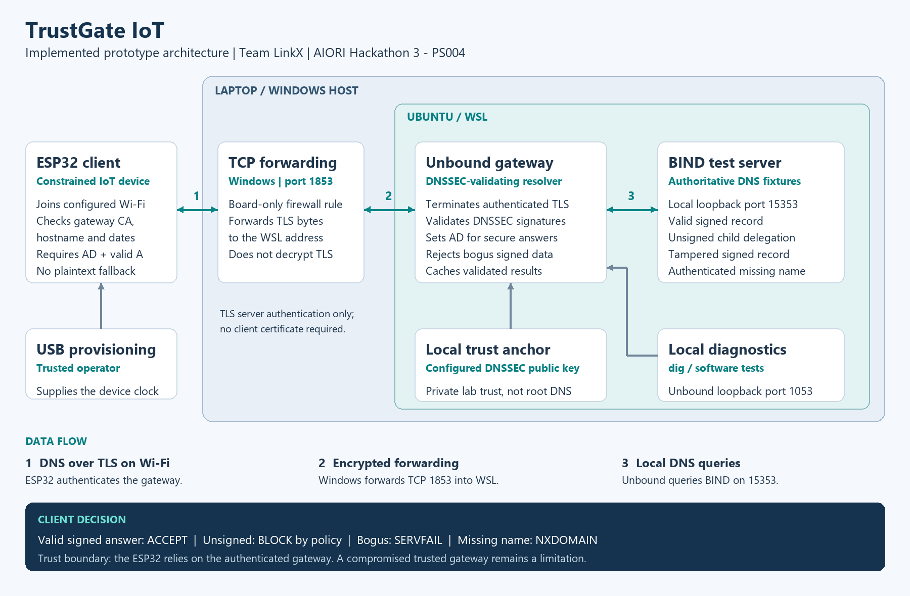
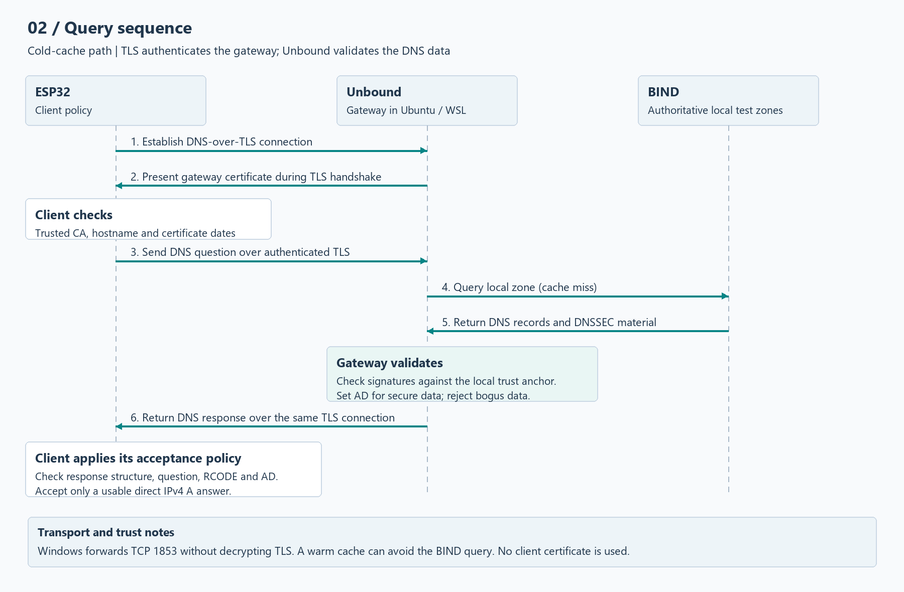
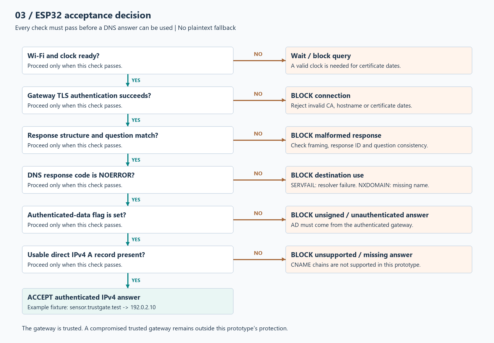

# TrustGate IoT - Team LinkX

**AIORI Hackathon 3 | A3-PS004-TC154 | CHRIST University**

## Team

- Lalit Kumar
- Sujitha V

## Problem statement

**PS-004: Authenticated Gateway-Assisted DNSSEC for IoT Clients**

Small IoT devices have limited processing power and memory. DNSSEC validation adds resource costs, while forged DNS responses can redirect devices to incorrect destinations. The challenge is to delegate validation to a trusted gateway and secure the client-to-gateway connection.

## Implemented prototype

Our prototype uses an ESP32 client and a local DNSSEC-validating gateway running Unbound. The client authenticates the gateway over DNS over TLS. The gateway validates DNS data against a configured trust anchor and rejects bogus answers.

The controlled lab tests valid signed data, an authenticated unsigned delegation, invalid signatures and untrusted or wrong-hostname gateway certificates. Unsigned data is distinct from bogus data; the strict client policy blocks unsigned answers.

The client relies on the trusted gateway. It does not independently perform end-to-end DNSSEC validation. A compromised trusted gateway remains a limitation.

## Evaluator starting point

- [Implementation report (PDF)](output/pdf/TrustGateIoT-Implementation-Report.pdf)
- [Demo walkthrough and architecture](docs/demo-walkthrough.md)
- [Submission status and mentoring guidance](docs/submission-checklist.md)
- [Download review package](deliverables/TrustGateIoT-Level2.zip)

The package is the 31 October review snapshot for local reproduction, not a hosted
live service. The latest demo link and diagrams are in the repository below.
The working demonstration is linked below; the introduction video describes
the original proposal. Current hardware evidence includes a 31 October run with
59 accepted requests and one startup block in 60 attempts; every attempt is saved.

## Working demo and architecture

[Watch the TrustGate IoT working demonstration on YouTube](https://youtu.be/goqmzNNO4qs)

Presented by Lalit Kumar on behalf of Team LinkX and teammate Sujitha V.
The demonstration covers ESP32 connectivity, DNSSEC validation, gateway
certificate rejection, recovery and recorded test evidence.

### System overview

Explore the query sequence

Explore the ESP32 acceptance policy

[Architecture notes and Mermaid source](docs/architecture/architecture.md) ·
[Tabbed viewer with zoom controls](docs/architecture/Architecture-Review.html)

To use the tabbed viewer, download or clone the repository and open the HTML file
in a browser. GitHub displays HTML source rather than running this viewer.
PNG and editable SVG diagrams are included in the same folder.

## Prototype code

The repository includes the Unbound gateway configuration, signed-zone lab,
Python client, ESP32 firmware and automated security checks.

- [Setup instructions](docs/setup.md)
- [Lab architecture and security limits](docs/local-lab.md)
- [ESP32 configuration and build](client/esp32/README.md)
- [Hardware test status](docs/hardware-status.md)
- [Reliability tests and initial measurements](docs/reliability-and-measurements.md)

The software suite passes 26 checks covering DNSSEC validation, strict client
policy, TLS certificate verification, TLS 1.2/1.3 compatibility and failure handling.
Test outputs are under `results/`. Hardware results are recorded separately.
Wi-Fi credentials, private keys and compiled firmware are excluded.

## Presentation

[Read the proposal PDF](Team_LinkX_PS004_Proposal.pdf)

The presentation follows the supplied structure: abstract, background, RFC review, proposed solution, optimizations, architecture, data flow, milestones and bibliography.

## Team introduction video

[Watch the team introduction and proposed solution](https://youtu.be/earyq23zmHI)

Meet Team LinkX and hear our approach to PS-004.

[Thumbnail](Team_LinkX_YouTube_Thumbnail.png)

## Evaluation plan

Planned measurements include latency, client CPU time and peak memory, with cold/warm caches and new/reused TLS sessions reported separately. Ordinary DNS is an overhead baseline; offloading savings require a comparable client-side validation baseline. Energy is measured only with suitable hardware.

## References

- [Official hackathon guidelines](https://portal.aiori.in/aiori-3/hackathon-guideline/)
- [RFC 4035 - DNSSEC protocol modifications](https://www.rfc-editor.org/rfc/rfc4035.html)
- [RFC 7858 - DNS over TLS](https://www.rfc-editor.org/rfc/rfc7858.html)
- [RFC 8310 - Authentication profiles](https://www.rfc-editor.org/rfc/rfc8310.html)
- [Unbound configuration](https://unbound.docs.nlnetlabs.nl/en/latest/manpages/unbound.conf.html)

