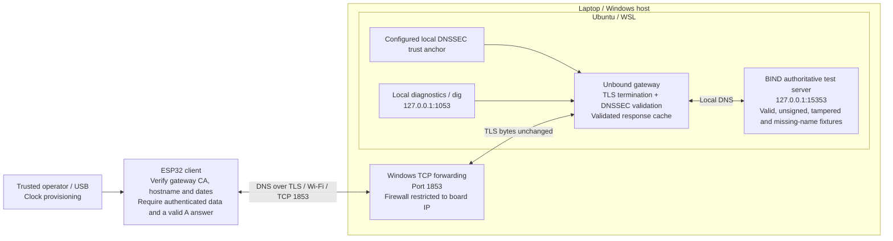

# TrustGate IoT architecture

Implemented local prototype. System overview, query sequence and client acceptance policy.

The TLS server identity is verified by the ESP32. TLS does not authenticate the
client with a client certificate in this prototype. Windows forwards the encrypted
connection; Unbound terminates it and validates DNSSEC against the local anchor.

The strict client blocks unsigned answers. Bogus signatures cause validation
failure; SERVFAIL alone does not prove the cause without gateway diagnostics.
NXDOMAIN can be an authenticated negative answer. There is no plaintext fallback.
The client relies on the trusted gateway; gateway compromise remains a limitation.
This lab does not demonstrate a public DNS root chain or a production deployment.
