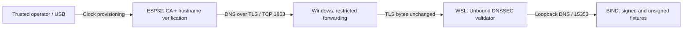

# Team LinkX: final demo walkthrough

Target duration: 7-8 minutes. Record real terminal output; do not present saved
results as a live run. Show the ESP32 and USB connection briefly at the start.
Label three tiled terminals: **ESP32 serial**, **gateway validation log**, and
**DNS diagnostics (WSL)**. Keep config.h and private key directories off screen.

## 0:00-1:00 - Problem and architecture

Say: "We are Team LinkX from CHRIST University: Lalit Kumar and Sujitha V.
TrustGate delegates DNSSEC validation to a gateway. Our ESP32 authenticates
the gateway using TLS, then applies a strict policy to its DNS answers."



Explain: Windows forwards encrypted bytes; Unbound terminates TLS and validates
DNSSEC. The local zone has a provisioned trust anchor, not a public-root chain.

## 1:00-2:30 - Valid and invalid DNS answers

Start the lab in Ubuntu after following docs/setup.md. Open one Windows serial
monitor at 115200 baud using `python scripts/monitor-board.py`; it provisions time.
In the gateway terminal, run `tail -f results/unbound.log` from the project folder.
In the diagnostics terminal:

```bash
dig @127.0.0.1 -p 1053 sensor.trustgate.test A +dnssec
dig @127.0.0.1 -p 1053 tampered.trustgate.test A +dnssec
dig @127.0.0.1 -p 1053 sensor.unsigned.trustgate.test A +dnssec
dig @127.0.0.1 -p 1053 missing.trustgate.test A +dnssec
```

Point out the valid answer's AD flag and ESP32 ACCEPT. Tampered data produces
SERVFAIL; pair it with the gateway's signature failure log to establish cause.
Unsigned data is not necessarily malicious, but our strict client blocks it.
NXDOMAIN is a legitimate authenticated negative result, not an attack.
Diagnostic UDP is loopback-only; the ESP32 uses TLS, not that UDP endpoint.

## 2:30-5:00 - Gateway authentication

Close the ordinary serial monitor before running
`python scripts/test-board-certificates.py`. It temporarily changes lab
certificates and restores the genuine gateway in a finally block.
Show the untrusted issuer and wrong-hostname cases, explicit board verification
errors, and successful recovery. Do not count socket timeouts as certificate
rejection evidence. The full script takes several minutes; if editing for length,
label cuts and retain the actual commands, error and restored success.

## 5:00-6:15 - Recovery and measurements

Show `results/esp32-recovery-tests.json` clearly labelled as recorded evidence,
or demonstrate one gateway restart live. Explain the limited two-cycle scope.
Show the cache benchmark separately from the ESP32 timings; neither establishes
battery savings. Include failed attempts and startup behavior in reliability claims.

## 6:15-7:30 - Reproduction and limitations

Show README, docs/setup.md, scripts and result JSON files. Explain the IP preflight,
local CA provisioning and private-key exclusions. State that real AP power loss,
controlled-network testing and production provisioning remain unfinished.
We have no Docker implementation to demonstrate; do not claim Docker support.

Conclude: "The prototype demonstrates delegated DNSSEC validation with an
authenticated gateway and fail-closed client behavior. The repository contains
reproduction steps and evidence, including the limitations we still need to test."

## Recording checklist

- Record both teammates' actual contributions without inventing roles.
- Keep architecture and terminal labels readable at normal video resolution.
- Show real hardware briefly; it need not stay visible throughout.
- Keep Wi-Fi passwords, private keys and meeting participant details out of frame.
- Upload the finished demo and add its URL to README. The existing introduction
  video is not a recording of the final working implementation.
